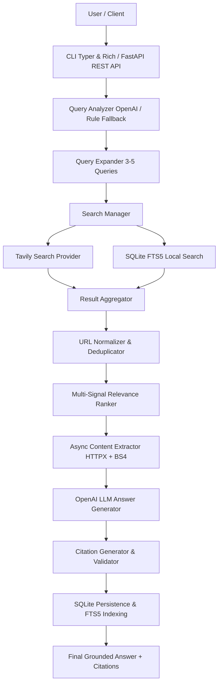

# 🔎 SeekAI — AI-Powered Custom Search Engine

SeekAI is a production-quality, custom search engine and retrieval pipeline built with Python 3.12+, FastAPI, SQLite FTS5, OpenAI, and Tavily. Rather than acting as a standard conversational chatbot, SeekAI executes a disciplined, grounded retrieval-augmented generation (RAG) pipeline: it understands search intent, expands queries, retrieves search results from the web or local full-text search, deduplicates URLs, calculates transparent relevance scores, extracts clean webpage contents, and synthesizes grounded answers with strict numeric citations ([1], [2]).

---

## 1. Project Overview

SeekAI transforms natural language questions into reliable answers backed by verifiable web and local documents. Key design tenets:
- **Never hallucinate facts:** Answers are synthesized exclusively from retrieved content.
- **Traceable citations:** Every claim links to an extracted source with its original URL.
- **Multi-modal retrieval:** Supports `web` search (via Tavily), `local` full-text search (via SQLite FTS5), and `hybrid` mode combining both.
- **Dual Interfaces:** Fully accessible through a terminal CLI (Rich + Typer) and a REST API (FastAPI + OpenAPI documentation).

---

## 2. Features

- **Query Understanding & Classification:** Classifies intent into categories (informational, navigational, transactional, recommendation, comparison, news, troubleshooting, academic).
- **Intelligent Query Expansion:** Expands complex queries into 3–5 targeted search queries.
- **Abstract Search Provider:** Pluggable interface (`SearchProvider`) with `TavilySearchProvider` implemented, with automatic retries and exponential backoff.
- **URL Normalization & Deduplication:** Cleans tracking parameters, trailing slashes, and anchor fragments, retaining the highest-scoring source when duplicates occur.
- **Transparent Relevance Ranking:** Combines search API confidence (60%), multi-field keyword density (20%), and source domain authority (20%).
- **Resilient Content Extraction:** Asynchronous HTTP client (HTTPX) + BeautifulSoup4 cleans noise tags (`<script>`, `<style>`, `<nav>`, `<footer>`) with timeout guards.
- **Hallucination Control & Citations:** Enforces grounding in OpenAI system prompts and numbers references `[1], [2]` mapped directly to retrieved URLs.
- **Real-Time News & Breaking RSS Crawling:** Automated background scraping workers for curated news domains and breaking RSS feeds (BBC, NPR, TechCrunch, The Verge, Hacker News, Ars Technica) with SQLite FTS5 search and Chroma vector store indexing.
- **Modern Web Frontend:** Next.js / React application connecting to `POST /ask` with streaming answers via Server-Sent Events (SSE), interactive citation chips, source cards, and breaking news ticker.
- **Authentication & Rate Limiting:** Multi-tenant deployment support with JWT and SHA-256 hashed API keys (`sk_live_...`), and a Redis-backed sliding window rate limiter with automatic in-memory fallback.
- **Local Full-Text Search (SQLite FTS5):** Indexes documents into a virtual SQLite FTS5 table with Porter stemmer tokenization for instant offline search.
- **Search History & Persistence:** Records queries, response times, intent, results, and answers in SQLite with foreign keys and WAL mode.
- **Performance Profiling & Verbose Pipeline:** Tracks and displays detailed timing across every phase (query analysis, search, extraction, LLM synthesis).

---

## 3. Architecture



---

## 4. Tech Stack

| Component | Technology | Rationale |
|-----------|------------|-----------|
| **Language** | Python 3.12+ (tested on Python 3.13) | Modern type hints, `asyncio`, high performance |
| **Web Framework** | FastAPI | High-performance async REST API with automatic OpenAPI documentation |
| **CLI Framework** | Typer & Rich | Polished terminal experience with colors, spinners, tables, and progress bars |
| **Search Provider** | Tavily Search API | Purpose-built AI search API returning clean snippets and scores |
| **LLM Provider** | OpenAI API (`gpt-4o-mini`, `gpt-4o`) | State-of-the-art reasoning and structured output capabilities |
| **Database** | SQLite + FTS5 | Zero-configuration database with native full-text search virtual tables |
| **HTTP Client** | HTTPX | Fast, asynchronous HTTP client for concurrent webpage scraping |
| **HTML Parsing** | BeautifulSoup4 + lxml | Robust HTML cleanup and boilerplate extraction |
| **Resilience** | Tenacity | Controlled retries with exponential backoff for network operations |
| **Testing** | Pytest, pytest-asyncio, pytest-mock | Automated testing with 100% mocked external calls |

---

## 5. Installation

### Prerequisites
- Python 3.12 or higher
- Windows PowerShell, CMD, or bash

### Windows Setup (PowerShell)

```powershell
# 1. Clone or navigate to the directory
cd "c:\Users\Ayush Sati\Downloads\SeekAI"

# 2. Create and activate a virtual environment
python -m venv .venv
.venv\Scripts\Activate.ps1

# 3. Install dependencies in editable mode
pip install -r requirements.txt
pip install -e .
```

### Windows Setup (Command Prompt - CMD)

```cmd
python -m venv .venv
.venv\Scripts\activate.bat
pip install -r requirements.txt
pip install -e .
```

---

## 6. Environment Variables

Create a `.env` file in the root directory by copying `.env.example`:

```bash
cp .env.example .env
```

Configure your credentials:

```dotenv
# Required API Keys
OPENAI_API_KEY=sk-proj-...
TAVILY_API_KEY=tvly-...

# LLM Configuration
OPENAI_MODEL=gpt-4o-mini

# Database Configuration
DATABASE_URL=data/search.db

# Search & Retrieval Limits
MAX_SEARCH_RESULTS=30
MAX_LLM_SOURCES=8
MAX_QUERIES_PER_EXPANSION=4
RESULTS_PER_QUERY=10

# Content Extraction & Limits
REQUEST_TIMEOUT=15
MAX_SOURCE_CHARS=12000

# Cache TTL (seconds)
CACHE_TTL=3600

# Logging Level (DEBUG, INFO, WARNING, ERROR)
LOG_LEVEL=INFO
```

---

## 7. API Key Setup

1. **OpenAI API Key**: Obtain from [platform.openai.com](https://platform.openai.com/api-keys).
2. **Tavily API Key**: Obtain a free search API key from [app.tavily.com](https://app.tavily.com).

*Note: If API keys are missing, the CLI gracefully alerts you with instructions rather than crashing, and automated tests run completely offline using mocks.*

---

## 8. Running the CLI

Once installed (`pip install -e .`), you can run `seekai` directly or via `.venv\Scripts\python cli.py`.

### 1. Ask a question (AI synthesis + citations)
```powershell
seekai ask "What are the advantages of quantum computing?"
```

### 2. Search web results (with AI answer)
```powershell
seekai search "What is machine learning?"
```

### 3. Search with options
```powershell
# Restrict to specific domains
seekai search "NIST cybersecurity guidelines" --domains nist.gov

# Filter by freshness (day, week, month, year)
seekai search "latest AI models" --freshness week

# Retrieve more results
seekai search "electric vehicle solid state battery" --max-results 20

# Raw search results only (no AI synthesis)
seekai search "Python async generators" --no-ai

# Verbose pipeline view (shows query expansion, timing, result counts)
seekai search "quantum supremacy" --verbose
```

### 4. Search locally indexed content (SQLite FTS5)
```powershell
seekai local-search "quantum"
```

### 5. Inspect history and saved answers
```powershell
# View recent searches
seekai history --limit 10

# Show saved answer and cited sources for search ID 1
seekai show 1

# View search engine statistics
seekai stats
```

---

## 9. Running FastAPI

Start the REST API server using Uvicorn:

```powershell
uvicorn app.main:app --reload --port 8000
```

Interactive documentation will be immediately accessible at:
- **Swagger UI**: [http://127.0.0.1:8000/docs](http://127.0.0.1:8000/docs)
- **ReDoc**: [http://127.0.0.1:8000/redoc](http://127.0.0.1:8000/redoc)

---

## 10. API Examples

### Health Check (`GET /health`)
```bash
curl -X GET "http://127.0.0.1:8000/health"
```
**Response:**
```json
{
  "status": "ok",
  "database": "connected",
  "search_provider": "available",
  "llm": "configured",
  "model": "gpt-4o-mini"
}
```

### Ask Query (`POST /ask`)
```bash
curl -X POST "http://127.0.0.1:8000/ask" \
  -H "Content-Type: application/json" \
  -d '{
    "query": "What is quantum computing?",
    "max_results": 10
  }'
```
**Response:**
```json
{
  "query": "What is quantum computing?",
  "answer": "Quantum computing is a rapidly-emerging technology that harnesses the laws of quantum mechanics to solve problems too complex for classical computers [1].",
  "sources": [
    {
      "id": 1,
      "title": "What is Quantum Computing? | IBM",
      "url": "https://www.ibm.com/topics/quantum-computing",
      "domain": "ibm.com",
      "citation_number": 1,
      "relevance_score": 0.94
    }
  ],
  "metadata": {
    "results_retrieved": 30,
    "results_after_deduplication": 24,
    "sources_used": 8,
    "response_time": 4.12
  },
  "search_id": 1
}
```

### Search History (`GET /history`)
```bash
curl -X GET "http://127.0.0.1:8000/history?limit=5"
```

### Usage Statistics (`GET /stats`)
```bash
curl -X GET "http://127.0.0.1:8000/stats"
```

---

## 11. Project Structure

```
SeekAI/
├── app/
│   ├── __init__.py
│   ├── main.py                  # FastAPI application factory & routes
│   ├── config.py                # Pydantic Settings & environment variables
│   │
│   ├── ai/                      # AI & LLM Components
│   │   ├── __init__.py
│   │   ├── client.py            # OpenAI Async wrapper (lazy init & safety)
│   │   ├── query_analyzer.py    # Intent detection & query structuring
│   │   ├── answer_generator.py  # Grounded answer synthesis & system prompts
│   │   └── citation_generator.py# Verifiable citation mapping & source linking
│   │
│   ├── api/                     # REST API Endpoints
│   │   ├── __init__.py
│   │   ├── routes_search.py     # POST /search, POST /ask
│   │   ├── routes_history.py    # GET /history, /history/{id}, /sources/{id}, /stats
│   │   └── routes_health.py     # GET /health, GET /
│   │
│   ├── cli/                     # CLI Interface
│   │   ├── __init__.py
│   │   └── commands.py          # Typer commands & Rich visual rendering
│   │
│   ├── database/                # SQLite & FTS5 Persistence
│   │   ├── __init__.py
│   │   ├── database.py          # Thread-safe SQLite connection & WAL mode
│   │   ├── schema.py            # DDL for searches, results, answers, FTS5 table
│   │   └── repository.py        # CRUD repository & FTS5 full-text querying
│   │
│   ├── models/                  # Pydantic Schemas & Data Models
│   │   ├── __init__.py
│   │   ├── search.py            # SearchRequest, SearchMode, SearchFreshness
│   │   ├── result.py            # SearchResult, QueryAnalysis
│   │   └── answer.py            # Source, SearchMetadata, AnswerResponse
│   │
│   ├── search/                  # Search & Retrieval Pipeline
│   │   ├── __init__.py
│   │   ├── base.py              # SearchProvider abstract base class
│   │   ├── tavily_provider.py   # Tavily web search implementation with retries
│   │   ├── search_manager.py    # Pipeline coordinator (web, local, hybrid)
│   │   ├── query_expander.py    # Generates 3-5 related sub-queries
│   │   ├── deduplicator.py      # URL normalization & highest score deduplication
│   │   ├── ranker.py            # Transparent multi-signal ranking formula
│   │   └── content_extractor.py # Async HTTPX + BS4 page cleaning & truncation
│   │
│   └── utils/                   # Helpers
│       ├── __init__.py
│       ├── url_utils.py         # URL normalization & domain parsing
│       ├── text_utils.py        # Text cleaning, whitespace stripping, truncation
│       └── logging_config.py    # Structured logging configuration
│
├── tests/                       # Automated Test Suite (Offline / Mocked)
│   ├── __init__.py
│   ├── test_search.py           # Deduplication tests
│   ├── test_deduplication.py   # URL normalization tests
│   ├── test_ranker.py          # Ranking and source quality tests
│   ├── test_query_analyzer.py  # Intent classification & query analysis tests
│   ├── test_database.py        # SQLite persistence & FTS5 tests
│   ├── test_api.py             # FastAPI REST endpoints tests
│   ├── test_content_extractor.py# HTML extraction and cleaning tests
│   ├── test_citation_generator.py# Citation extraction and mapping tests
│   └── test_answer_generator.py # Grounded answer generation tests
│
├── data/                        # SQLite storage directory
│   └── .gitkeep
│
├── cli.py                       # Standalone CLI entrypoint
├── requirements.txt             # Pip dependencies
├── pyproject.toml               # Project metadata & build configuration
├── .env.example                 # Example configuration template
├── .gitignore                   # Ignored files (secrets, database, caches)
└── README.md                    # Documentation
```

---

## 12. Database Architecture

SQLite (`data/search.db`) runs in Write-Ahead Logging (WAL) mode with foreign keys enabled:

1. **`searches`**: Stores query, normalized query, intent, search mode, response time, and result count.
2. **`results`**: Stores search results with raw search score, keyword relevance, source quality score, and final score.
3. **`answers`**: Stores LLM answer text, model identifier, and timestamp.
4. **`sources`**: Stores cited sources linking answer ID, citation number, title, and URL.
5. **`cache`**: Stores serialized query responses with configurable TTL.
6. **`documents` (Virtual FTS5 Table)**: Full-text search index containing `title`, `content`, `url`, and `domain` tokenized with the Porter stemmer.

---

## 13. Search Pipeline & Ranking Formula

Every search query goes through the pipeline:
1. **Query Analysis:** Detects intent (`informational`, `navigational`, `troubleshooting`, `news`, etc.) and determines if recent time-freshness is required.
2. **Query Expansion:** Generates 3–5 targeted queries to maximize retrieval breadth.
3. **Multi-Query Retrieval:** Concurrent queries sent to Tavily or SQLite FTS5.
4. **URL Normalization & Deduplication:** Removes tracking parameters (`utm_*`, `fbclid`), trailing slashes, and anchor hashes `#`. If the same page is returned across queries, only the version with the highest search score is kept.
5. **Relevance Ranking Formula:**
   $$\text{Final Score} = 0.60 \times S_{\text{search}} + 0.20 \times S_{\text{keyword}} + 0.20 \times S_{\text{quality}}$$
   - $S_{\text{search}}$: Normalized search engine confidence score ($0.0 - 1.0$).
   - $S_{\text{keyword}}$: Keyword match weighted by location (Title = 1.0, Snippet = 0.6, Content = 0.3).
   - $S_{\text{quality}}$: Domain authority weight (`.gov`, `.edu`, trusted scientific/news outlets receive top scores).
6. **Async Content Extraction:** Downloads and strips HTML boilerplate, scripts, ads, and footers.
7. **Grounded Synthesis:** OpenAI LLM answers the prompt using retrieved context only, referencing claims with `[1], [2]`.
8. **Citation Linking:** Citations are verified against actual retrieved documents.

---

## 14. Testing Instructions

All unit and integration tests are isolated from external APIs using mocks. No API keys are required to run tests.

Run the complete test suite:

```powershell
# Run with full verbose output
pytest -v

# Run with test coverage
pytest --tb=short
```

Expected result:
```
70 passed in ~2s
```

---

## 15. Troubleshooting

- **Windows Unicode / Emoji Error (`charmap` codec error):**
  SeekAI automatically configures Windows terminal `stdout` and `stderr` to UTF-8 and disables legacy Windows terminal rendering in Rich. If you still encounter encoding issues in legacy CMD, run `chcp 65001` before executing commands.
- **Missing API Keys Error:**
  If you see `[ERROR] Required API keys are missing`, verify that `.env` is created in the project root directory and contains valid keys.
- **Database Lock:**
  The SQLite connection utilizes WAL mode (`PRAGMA journal_mode = WAL`) to support high concurrency between reads and writes.

---

## 16. Newly Implemented Capabilities

### ⚡ 1. Real-Time News & RSS Crawling
- **Worker:** `NewsCrawlerWorker` runs continuously in the background on startup (interval configurable via `CRAWLER_INTERVAL_SECONDS`).
- **Curated Feeds:** Seeds BBC World, NPR, Hacker News, TechCrunch, The Verge, and Ars Technica.
- **FTS5 & Vector Indexing:** Parsed articles are indexed into SQLite FTS5 (`news_documents`) and semantic vector store (`ChromaVectorStore`).
- **Search Mode:** Queries can use `SearchMode.news` or automatic breaking news routing.
- **API Endpoints:**
  - `GET /crawler/status` — Live worker health, feed counts, article stats.
  - `POST /crawler/run` — Manually trigger an immediate crawl cycle.
  - `GET /crawler/feeds` & `POST /crawler/feeds` — Manage RSS feeds.
  - `GET /crawler/articles` — Search and retrieve breaking news articles.

### 🌐 2. Modern Web Frontend (Next.js / React)
- **App Location:** Located in [`frontend/`](file:///c:/Users/Ayush%20Sati/Downloads/Projects/SeekAI/frontend).
- **Aesthetics & Design:** Obsidian dark glassmorphism, glowing accents, responsive cards, and modern typography.
- **Streaming Answers:** Streams answers token-by-token from `POST /ask` (or `POST /ask/stream`) via Server-Sent Events (SSE).
- **Interactive Citations:** Numbered citation badges (`[1]`, `[2]`) in the streamed answer highlight the corresponding verified source card on click/hover.
- **Breaking News Panel:** Real-time ticker and slide-out drawer with 1-click query generation.
- **Run Locally:**
  ```powershell
  cd frontend
  npm run dev
  # Access at http://localhost:3000
  ```

### 🔐 3. Authentication & Sliding Window Rate Limiting
- **Multi-Tenancy:** Tenants are isolated with tier-based quotas (`free`, `pro`, `enterprise`).
- **Auth Protocols:**
  - JWT Tokens signed via HMAC-SHA256 (`Authorization: Bearer <jwt>`).
  - Cryptographic API keys prefixed with `sk_live_` and hashed with SHA-256 (`X-API-Key: ...`).
- **Rate Limiting:** Distributed Redis-backed sliding window rate limiter (`ZREMRANGEBYSCORE`, `ZCARD`, `ZADD`) with in-memory fallback for local environments without Redis.
- **Standard Headers:** Automatically sets `X-RateLimit-Limit`, `X-RateLimit-Remaining`, `X-RateLimit-Reset`, and `Retry-After` on HTTP 429.
- **Auth Endpoints:**
  - `POST /auth/token` — Issue access token for a tenant.
  - `POST /auth/api-keys` — Provision a new secret API key.
  - `GET /auth/me` — Inspect tenant identity and live quota status.
